# N-Logistics

A Java-based logistics management system designed to manage company operations, users, container allocation, pricing and access permissions.

This project was developed as part of a group internship project. My contribution focused on **Module 3 and its Role-Based Access Control (RBAC) implementation**.

---

## About the Project

N-Logistics is a web-based logistics management application consisting of two web modules deployed on an Apache Tomcat server.

The system provides functionality for company management, user administration, container operations, allocation, pricing and demand forecasting.

The application uses Java Servlets, JSP and MySQL/MariaDB for its backend and database operations.

## Project Modules

| Module | Main Responsibilities |
|---|---|
| Module 1 – Import Export | Login, company registration and approval, user management, roles, audit logging and password reset |
| Module 3 – Logistics Management | Container management, allocation, pricing, pricing audit, demand forecasting and RBAC |

Both modules work as separate web applications and communicate through a signed Single Sign-On (SSO) token.

## Features

### Authentication and User Management
- User login and session management
- Company registration and approval
- User and role management
- Password reset functionality
- Role-based access permissions

### Container Management
- Container catalogue
- Add, update and delete container records
- Container status management
- Container ownership management
- Container image upload functionality

### Allocation Management
- Container allocation and release
- Company-based access restrictions
- Separate allocation and release workflows

### Pricing Management
- Container pricing operations
- Pricing rules
- Pricing audit records
- Configurable pricing surcharge

### Demand Forecasting
- Demand forecasting functionality
- Forecast records stored in the database

### Security
- Role-Based Access Control (RBAC)
- Server-side authorization checks
- CSRF protection for POST requests
- BCrypt password hashing
- Session timeout handling
- Signed SSO token verification
- Permission-denial logging

## My Contribution

This was a group project, and my primary contribution was **Module 3 and its authorization layer**.

My work included:

- Implementing Role-Based Access Control.
- Restricting features according to user roles.
- Implementing server-side authorization checks.
- Applying company-level access restrictions.
- Working with container management and allocation functionality.
- Working with pricing and pricing audit functionality.
- Integrating authorization checks with the Module 3 controllers.

The authorization implementation is located in:

`NLogisticsModule3/src`

The main authorization class is:

`Module3Authorization.java`

## Role-Based Access Control

The system supports the following roles:

| Role | Access |
|---|---|
| Super Admin | Overall system management |
| Company Admin | Company operations and user management |
| Operations Staff | Container operations and allocation |
| Finance Staff | Pricing and pricing audit |
| Customer | Own container information and final pricing |

Authorization is checked on the server side rather than relying only on whether a button or link is visible in the interface.

Company-specific operations use the authenticated user's company context.

## Technology Stack

| Technology | Purpose |
|---|---|
| Java 8 | Backend programming |
| Java Servlets | Request handling |
| JSP | Dynamic web pages |
| JDBC | Database connectivity |
| MySQL / MariaDB | Database |
| Apache Tomcat 8.5 | Application server |
| HTML, CSS, JavaScript | Frontend |
| Bootstrap 5 | UI styling |
| BCrypt / jBCrypt | Password hashing |
| Eclipse IDE | Development environment |
| Git and GitHub | Version control |

## Project Structure

```text
N-logistics/
│
├── NLogisticsImportExport/
│   ├── src/
│   └── WebContent/
│
├── NLogisticsModule3/
│   ├── src/
│   └── WebContent/
│
├── database/
│   ├── schema.sql
│   └── seed.sql
│
├── config/
│   └── setenv.example.bat
│
├── README.md
├── LICENSE
└── .gitignore
```

## Database Setup

The project uses a database named:

`logistics_db`

Create the database:

```sql
CREATE DATABASE logistics_db;
```

Import the database structure:

```bash
mysql -u root -p logistics_db < database/schema.sql
```

For local development, optional demo data can be inserted using:

```bash
mysql -u root -p logistics_db < database/seed.sql
```

The seed file creates a development Super Admin account for local testing only.

**Security note:** The demo credentials are publicly available in the development seed file. Do not use this account or its password in a production environment.

## Application Configuration

A sample configuration file is provided:

`config/setenv.example.bat`

Copy this file to the Tomcat `bin` directory and rename the copy to:

`setenv.bat`

Update the environment variables with your local database credentials and SSO secret.

The same SSO secret must be configured for both web applications.

Do not commit your actual `setenv.bat` file or any real credentials.

## Running the Project

### Prerequisites

- JDK 8
- Apache Tomcat 8.5
- MySQL 8 or MariaDB 10.4
- Eclipse IDE for Enterprise Java Developers

### Setup

1. Clone this repository.
2. Configure the database using the SQL files in the `database` folder.
3. Configure the required environment variables in Tomcat.
4. Import both web projects into Eclipse.
5. Configure Apache Tomcat in Eclipse.
6. Deploy both applications to Tomcat.
7. Start Module 1 first.
8. Open the Module 1 application and log in.
9. Access Module 3 through the application's navigation.

The configured local Module 1 URL in the project documentation is:

`http://localhost:8081/NLogisticsImportExport/`

The port may need to be adjusted to match your local Tomcat configuration.

## Screenshots

## Screenshots

The following screenshots demonstrate the application's user interface and major functionalities.

### 1. Authentication

The login interface used to access the N-Logistics application.

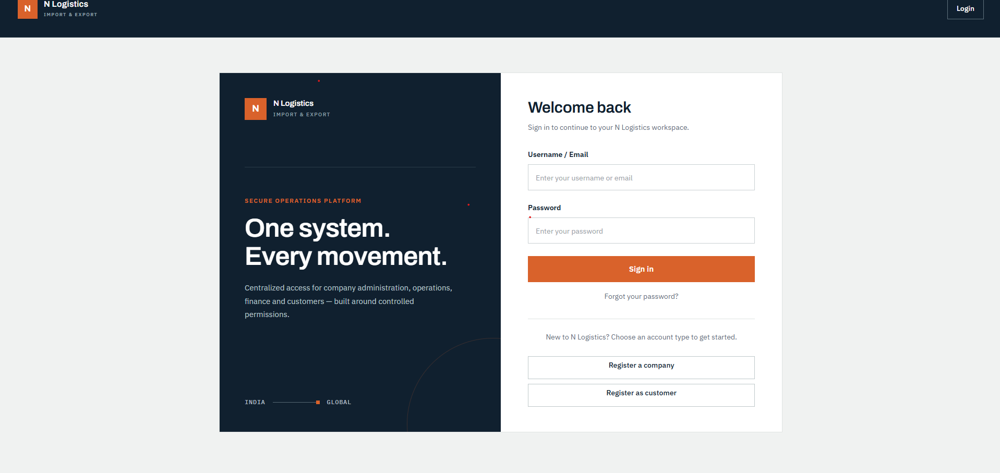

### 2. Dashboard

The dashboards provide an overview of the application's available operations and management features.

**Main Dashboard**

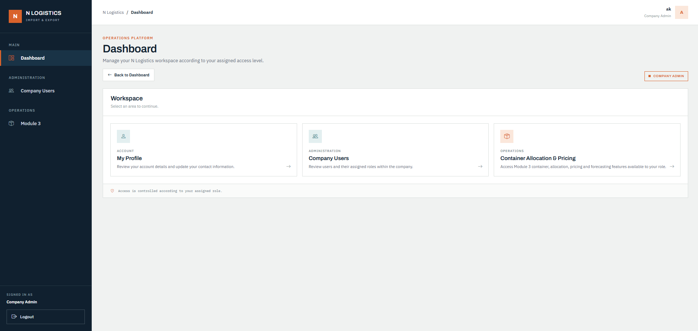

**Additional Dashboard View**

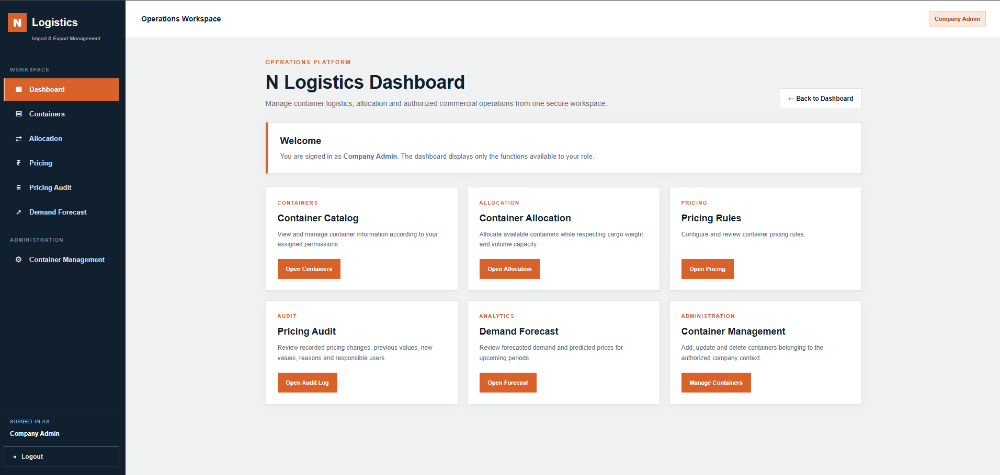

### 3. Container Management

Container management functionality, including viewing and adding container records.

**Container Management**

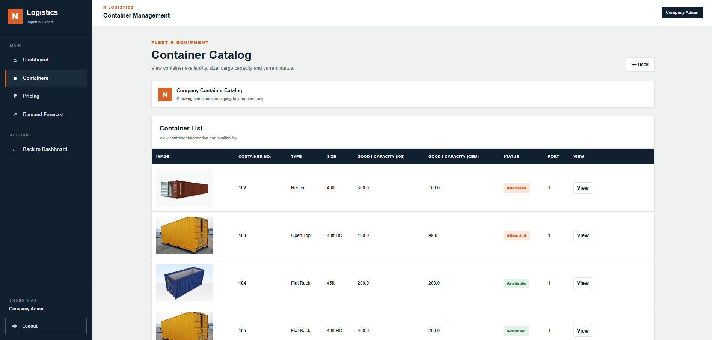

**Add Container**

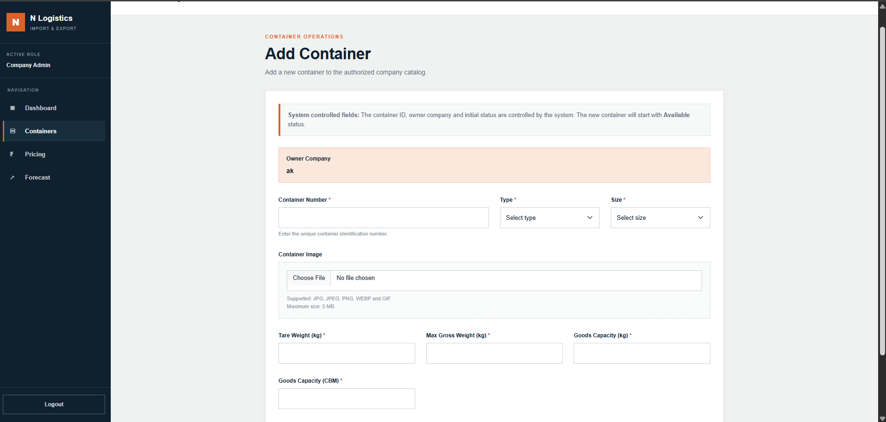

### 4. Container Allocation and Release

The allocation module supports container allocation and release operations.

**Customer Container Allocation**

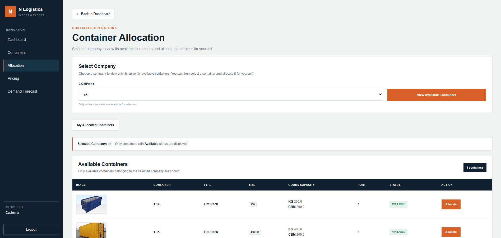

**Release Container**

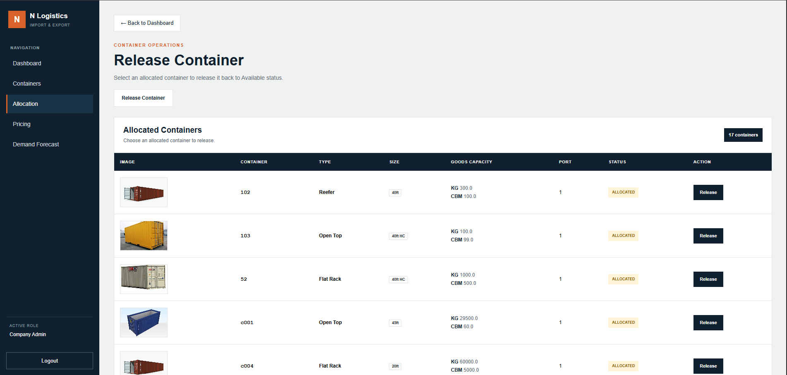

### 5. Pricing Management

Pricing rules and pricing audit functionality.

**Pricing Rules**

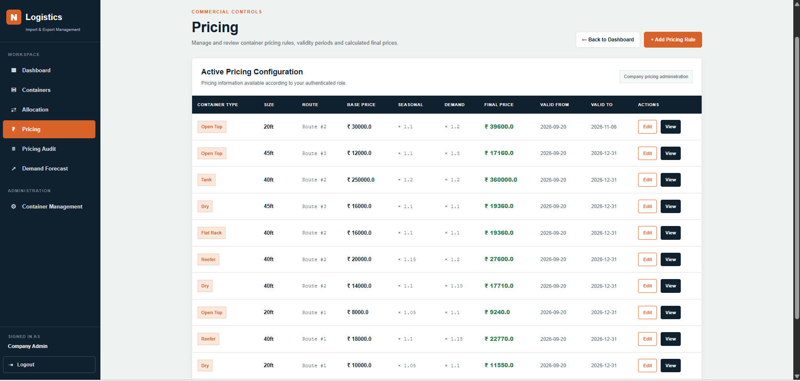

**Pricing Audit**

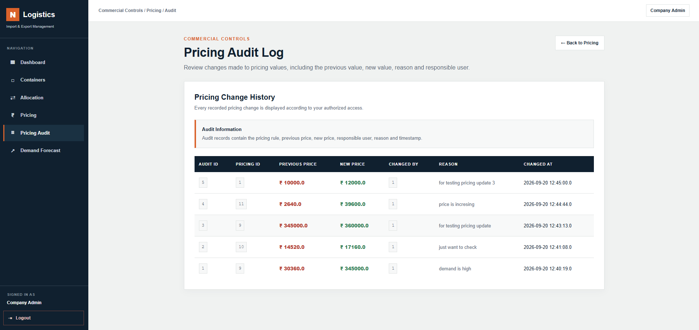

### 6. Demand Forecasting

The demand forecasting interface provides a view of the application's forecasting functionality.

**Forecast View 1**

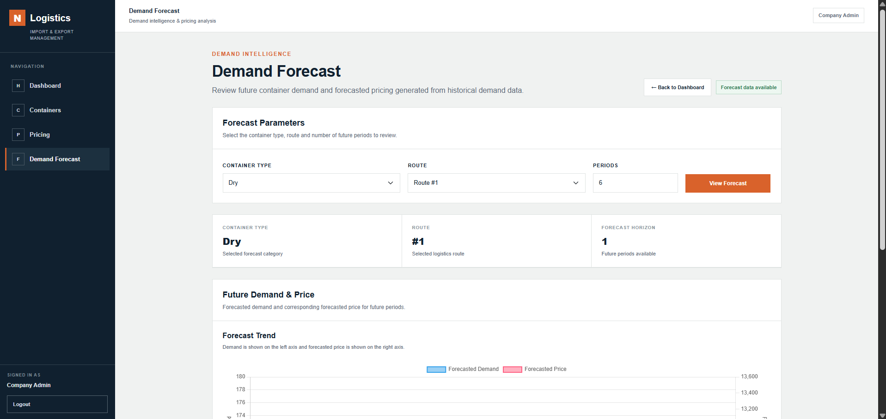

**Forecast View 2**

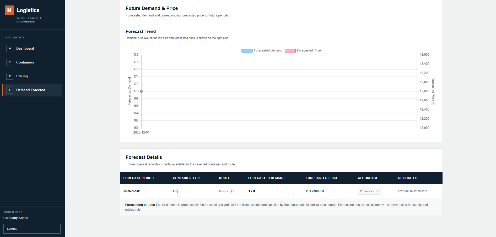

### 7. Customer Portal

Customer-facing dashboard and pricing information.

**Customer Dashboard**

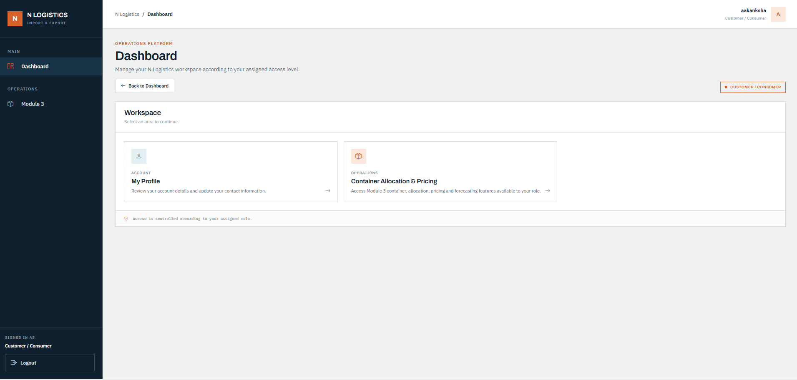

**Additional Customer Dashboard View**

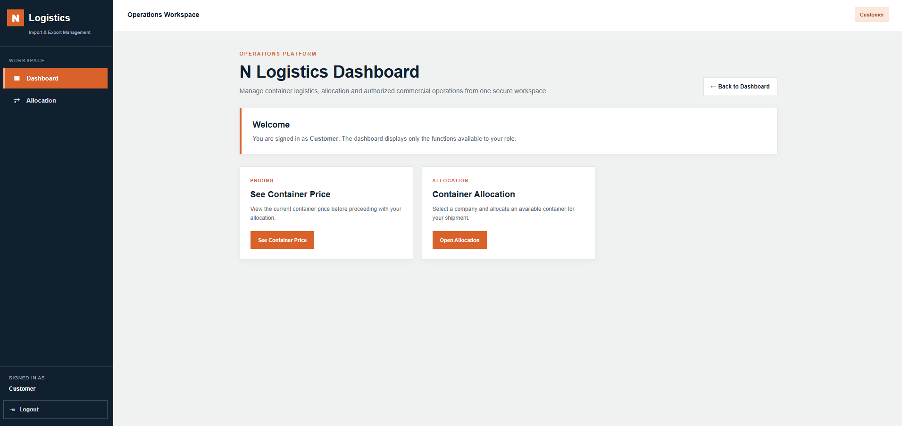

**Customer Pricing**

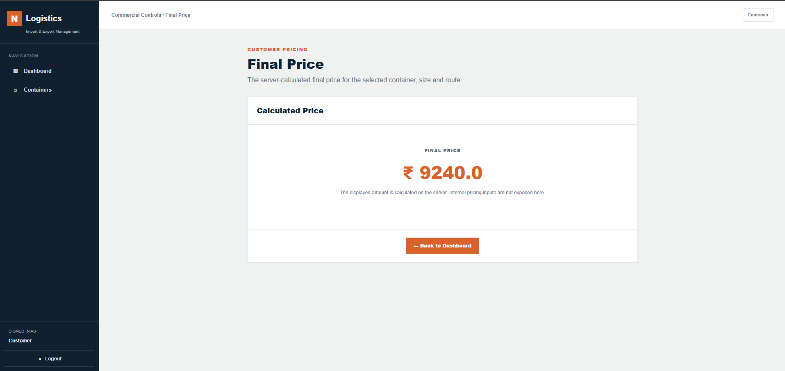

## Current Limitations

- The repository contains Module 1 and Module 3; Module 2 is not included.
- Automated test coverage is not currently included.
- Some business logic is implemented through MySQL stored procedures.
- The supplied database schema does not include a complete port and route master-data module.

## Project Information

**Project:** N-Logistics  
**Project Type:** Group Internship Project  
**My Contribution:** Module 3 and Role-Based Access Control  
**Development Environment:** Eclipse IDE

---

Thank you for visiting the project repository.